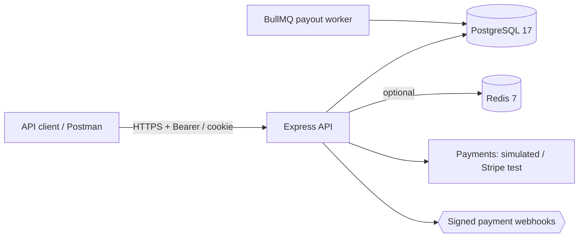

# NEXUS BANK

[](https://github.com/AmrKhaled000/nexus-bank-api/actions/workflows/ci.yml)
[](LICENSE)
[](https://nodejs.org/)
[](https://www.typescriptlang.org/)
[](https://www.postgresql.org/)
[](https://www.prisma.io/)

**Educational digital banking and wallet-management API.** NEXUS BANK is a production-quality
reference implementation of a retail bank/wallet backend: double-entry ledger, immutable audit
trail, rotating refresh tokens, TOTP two-factor auth, PINs, idempotent financial APIs and a
signed-webhook payment flow — built so the security and consistency properties can be studied,
tested and reproduced locally.

> **Simulation notice.** No real money moves. There is no card network, no bank rail, no KYC
> provider and no SWIFT/SEPA/ACH connectivity. Deposits and payouts go through a deterministic
> *simulated* provider (or Stripe test mode behind the same interface). Do not use this to
> process real funds, and do not point the demo credentials at any real identity.
>
> **Fictional brand domain.** `nexusbank.example.com` appears throughout the docs, configs and
> OpenAPI document as the demonstration deployment domain. It is a placeholder under the reserved
> `example.com` namespace — it is **not a live service** and nothing in this repository refers to
> a real bank.

---

## Feature matrix

| Area | What is implemented |
|---|---|
| Money & ledger | Integer minor units end-to-end (`BIGINT`), double-entry journal, immutable/append-only ledger, SQL-enforced journal balance + wallet projections, balance reconciliation endpoint, trial balance |
| Accounts | Register → verify → login, Argon2id passwords, Argon2id+HMAC PINs, TOTP 2FA (encrypted at rest), RBAC (`CUSTOMER`, `SUPPORT`, `FINANCE_ADMIN`, `SUPER_ADMIN`) |
| Sessions | Rotating refresh tokens (hashed at rest, reuse detection → family revocation), HttpOnly SameSite=Strict cookie scoped to `/api/v1/auth`, session list/revoke/logout-all, max active sessions |
| Wallets | Multiple wallets, currencies (USD/EUR/GBP), primary wallet, balance projections, holds (reserved funds), close with zero-balance invariant |
| Transfers | PIN-protected, limits, idempotency, fee-free policy, reversal by staff (admin confirmation + reason + audit) |
| Deposits | Hosted-checkout style intent → signed webhook settlement; `POST /deposits/:id/simulate` for the sandbox; Stripe test mode optional |
| Withdrawals | Amount+fee holds, review threshold, `AUTO_APPROVE_WITHDRAWALS` for sandbox, simulated payout rails success/failure, admin retry for stuck payouts |
| Idempotency | Shared-record transaction: financial op and idempotency key commit/rollback together; 24h replay, payload-hash conflict detection |
| Payments infra | HMAC-signed webhooks with timestamp tolerance, replay protection via `(provider, eventId)` uniqueness, amount/currency cross-checks |
| Admin | User status/role management (typed confirmations), ledger adjustments, transfer reversals, withdrawal review, reconciliation, audit log, security events, stats |
| Observability | Structured pino logs (request ids, redaction), Prometheus `/metrics`, OpenTelemetry (optional), health/readiness probes, webhook/ledger counters |
| Ops | Prisma migrations, idempotent seed, Dockerfile, docker-compose, GitHub Actions CI, OpenAPI 3.1 + Swagger UI, Postman collection, docs |

## Architecture at a glance



See [docs/ARCHITECTURE.md](docs/ARCHITECTURE.md) for the full C4-style breakdown, module map and
decision records; [docs/FINANCIAL_LEDGER.md](docs/FINANCIAL_LEDGER.md) for the ledger design.

## Getting started

### Prerequisites

- Node.js ≥ 20.11 and npm
- PostgreSQL 17 (local install or Docker)
- Redis 7 (optional; set `QUEUE_ENABLED=false` to run without it)

### Local development (Linux/macOS/WSL/Windows)

```bash
npm ci
cp .env.example .env          # then edit values (see comments inside)
npx prisma migrate deploy     # create schema in nexus_bank
npx prisma db seed            # currencies, limits, fees + demo accounts
npm run dev                   # http://localhost:3000
```

Docker-only quickstart (demo stack):

```bash
docker compose up --build                 # db + redis + api (+ worker) on :3000
docker compose --profile demo up --build  # additionally seeds demo data
```

CI also builds the exact production image and smoke-tests it (`GET /health/ready` must return
`200` with `"ready": true`) on every push — see the `docker` job in `.github/workflows/ci.yml`.

### Demo credentials (simulation only)

| Email | Role | Password | PIN |
|---|---|---|---|
| `alice@nexusbank.test` | `CUSTOMER` | `NexusDemo#2026` | `246810` |
| `bob@nexusbank.test` | `CUSTOMER` | `NexusDemo#2026` | `246810` |
| `finance@nexusbank.test` | `FINANCE_ADMIN` | `NexusDemo#2026` | `246810` |
| `admin@nexusbank.test` | `SUPER_ADMIN` | `NexusDemo#2026` | `246810` |

Alice is pre-funded with `5000.00` USD (and owns a EUR savings wallet); Bob with `2000.00` USD. Both
have simulated payout bank accounts on file.

### First request walkthrough

```bash
# 1. Sign in as Alice (verification emails go to the .dev-mail file transport in development)
curl -s -X POST http://localhost:3000/api/v1/auth/login \
  -H 'Content-Type: application/json' \
  -d '{"email":"alice@nexusbank.test","password":"NexusDemo#2026"}'

# 2. List wallets (use the accessToken from the login response)
curl -s http://localhost:3000/api/v1/wallets \
  -H "Authorization: Bearer $ACCESS_TOKEN"

# 3. Make a simulated deposit, then "confirm" it via the signed sandbox webhook
curl -s -X POST http://localhost:3000/api/v1/deposits \
  -H "Authorization: Bearer $ACCESS_TOKEN" \
  -H "Content-Type: application/json" \
  -H "Idempotency-Key: deposit-example-0001" \
  -d '{"walletId":"<WALLET_ID>","amount":"100.00"}'

curl -s -X POST "http://localhost:3000/api/v1/deposits/<DEPOSIT_ID>/simulate" \
  -H "Authorization: Bearer $ACCESS_TOKEN" \
  -H 'Content-Type: application/json' \
  -d '{"outcome":"completed"}'
```

The interactive contract lives at **`http://localhost:3000/docs`** (Swagger UI); the raw spec at
`/openapi.json`; the Postman collection at `postman/NEXUS_BANK.postman_collection.json`.

## Scripts

| Command | Purpose |
|---|---|
| `npm run dev` | Dev server with hot reload (tsx) |
| `npm run build` / `npm start` | Compile to `dist/` / run compiled server |
| `npm run worker` | BullMQ payout worker (requires Redis) |
| `npm run typecheck` | Strict `tsc --noEmit` |
| `npm run lint` / `npm run lint:fix` | ESLint (zero-error policy) |
| `npm test` | Unit + integration tests |
| `npm run test:unit` | Fast, database-free tests |
| `npm run test:integration` | Full HTTP+Postgres suite (auto-migrates `nexus_bank_test`) |
| `npm run test:coverage` | Coverage report (unit) |
| `npm run prisma:deploy` / `prisma:seed` / `prisma:migrate` | Schema lifecycle |
| `npm run openapi:export` | Write `docs/openapi.generated.json` |
| `npm run postman:export` | Regenerate the Postman collection from the OpenAPI document |

## Testing

- **Unit** (`tests/unit`): money arithmetic, crypto, webhook signatures, RBAC matrix — no database.
- **Integration** (`tests/integration`): real HTTP against a real PostgreSQL (`nexus_bank_test`),
  sequential execution, full ledger verification, idempotency replay, double-spend prevention,
  webhook signature/amount/deduplication, withdrawals + holds, admin RBAC + confirmations,
  DB-level immutability of journal/audit tables.
- Integration tests **refuse to run** unless `DATABASE_URL` targets `nexus_bank_test` — they will
  never touch a development or production database.

## Documentation map

| Document | Contents |
|---|---|
| [docs/ARCHITECTURE.md](docs/ARCHITECTURE.md) | Layers, module map, key data flows, decision records |
| [docs/DATABASE_DESIGN.md](docs/DATABASE_DESIGN.md) | Schema, constraints, triggers, integrity invariants |
| [docs/FINANCIAL_LEDGER.md](docs/FINANCIAL_LEDGER.md) | Double-entry rules, chart of accounts, worked examples |
| [docs/TRANSACTION_FLOWS.md](docs/TRANSACTION_FLOWS.md) | Step-by-step flows: deposit, withdrawal, transfer, reversal, expiry |
| [docs/API_DOCUMENTATION.md](docs/API_DOCUMENTATION.md) | Conventions, auth, idempotency, errors, admin confirmations |
| [docs/SECURITY.md](docs/SECURITY.md) | Controls catalogue + operator guidance |
| [docs/THREAT_MODEL.md](docs/THREAT_MODEL.md) | STRIDE analysis and residual risks |
| [docs/DEPLOYMENT.md](docs/DEPLOYMENT.md) | Production checklist, Docker, compose, CI/CD, observability |
| [docs/CONTRIBUTING.md](docs/CONTRIBUTING.md) | Dev workflow, test policy, migration policy, PR checklist |

## Safety and legal

NEXUS BANK is an educational artifact. It was designed to be *read alongside* OWASP guidance and
real core-banking literature. It is not an endorsed reference for any regulator, and it is not
financial advice. If you fork it, keep the simulation honest: never wire it to real payment rails
without a compliance program, licensure and professional review.

License: MIT (see `LICENSE` — implied by `package.json`).
