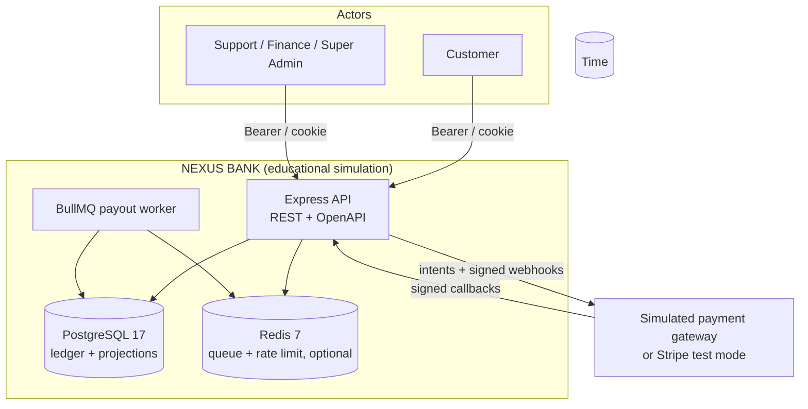
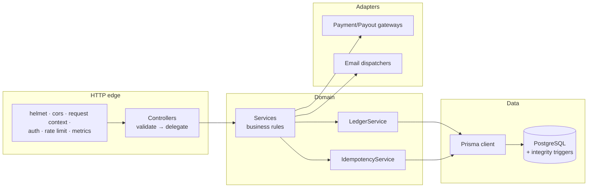
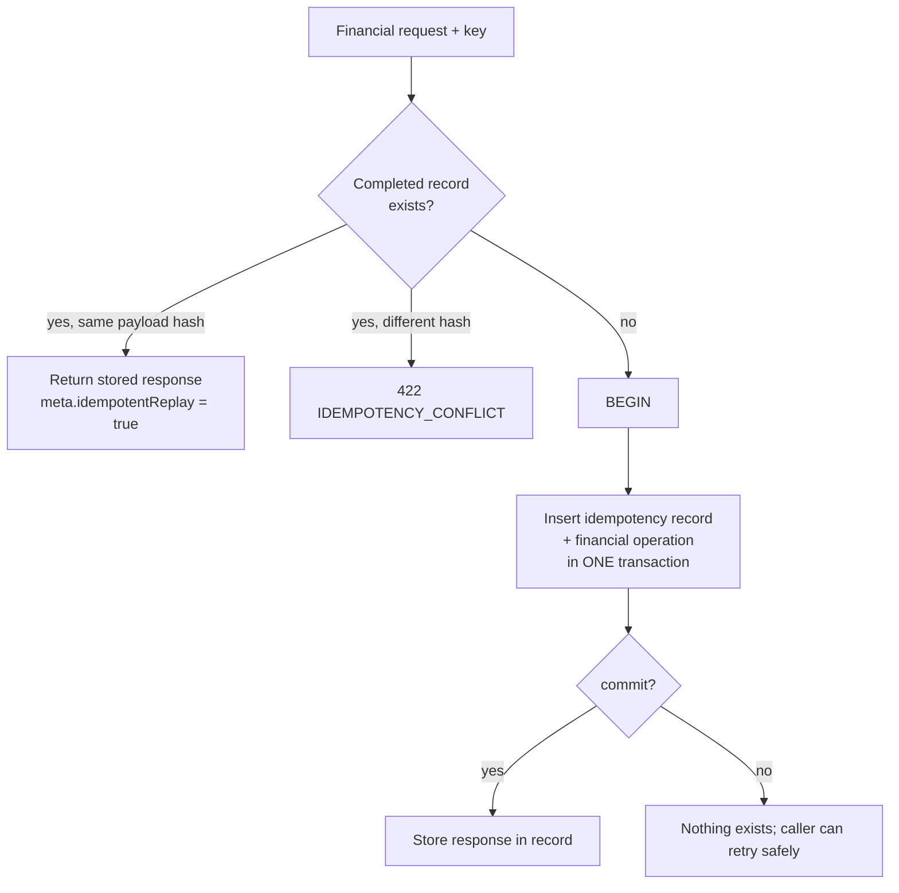

# NEXUS BANK — Architecture

This document explains how the system is put together and *why* the load-bearing decisions were
taken. Code references are paths in this repository.

## Quality goals (in priority order)

1. **Financial correctness** — money is never duplicated, created from nothing, or shown against a
   broken balance. Enforced by the ledger, SQL constraints, and deferred constraint triggers.
2. **Security** — credential theft, token replay, ledger tampering and audit-log evasion must be
   hard by default (Argon2id, TOTP, rotating refresh tokens, RBAC, admin confirmations, immutable
   tables).
3. **Determinism** — given the same input, concurrent requests interleave the same way every time
   (advisory locks per user, row locks in wallet-account order, no external I/O under locks).
4. **Operability** — probes, metrics, structured logs, idempotent migrations, docker-compose.
5. **Clarity** — a reader should be able to trace any request end-to-end in minutes.

## C4: system context



## C4: containers & layers



Layers and their rules:

| Layer | Path | May call | Must not |
|---|---|---|---|
| HTTP/middleware | `src/app.ts`, `src/middleware/*` | Express, services | Business rules, SQL |
| Controllers | `src/modules/**/*.controller.ts` | Services (or DTO mapping) | Prisma, cross-module internals |
| Services | `src/modules/**/*.service.ts` | Repositories, ledger, idempotency, gateways, notifications | Express `req/res` |
| Ledger/repository | `src/modules/ledger`, `*/wallet.repository.ts`, `transactions/transaction.repository.ts` | Prisma | HTTP concerns |
| Schema/migration | `prisma/schema.prisma`, `prisma/migrations/*` | SQL/Prisma | Application logic |

Cross-cutting concerns live in `src/common` (crypto, money, permissions, errors, ids) and
`src/infrastructure` (database client, email, payments, queue, logging, observability).

## Composition roots

- `src/container.ts` (`createServices`) wires every dependency once and is shared by the HTTP
  process and the worker. Nothing constructs its own database pool except this file.
- `src/app.ts` (`createApplication`) builds the Express app without listening, so integration tests
  drive it in-process with Supertest.
- `src/server.ts` starts HTTP, fails fast when the database is unreachable, registers graceful
  shutdown (HTTP drain → expiry timers → BullMQ), and exposes `/health*`.
- `src/workers/index.ts` runs the payout worker and the stale-deposit expiry loop.

## Key data flows

### Request lifecycle

```mermaid
sequenceDiagram
  autonumber
  participant C as Client
  participant E as Express
  participant A as Auth middleware
  participant S as Service
  participant L as Ledger
  participant D as PostgreSQL
  C->>E: POST /api/v1/transfers<br/>Authorization: Bearer …<br/>Idempotency-Key: …
  E->>A: authenticate (session + status check)
  A-->>E: req.auth { userId, role, sessionId, emailVerified }
  E->>S: TransferService.create(userId, body, { key, requestHash })
  S->>S: verify PIN (outside the financial tx)
  S->>D: BEGIN; lock advisory(user); lock wallet rows (id order)
  S->>S: limits, balance check
  S->>D: insert transaction + transfer + journal lines
  S->>L: post balanced journal (projection kept in sync)
  S->>D: upsert idempotency record (same COMMIT)
  D-->>S: COMMIT (constraint triggers re-verify balances)
  S-->>E: 201 Transfer DTO
  E-->>C: { success: true, data, meta: { idempotentReplay: false } }
```

### Webhook settlement (signed)

```mermaid
sequenceDiagram
  autonumber
  participant P as Payment provider
  participant E as Express
  participant W as PaymentWebhookService
  participant L as Ledger
  participant D as PostgreSQL
  P->>E: POST /api/v1/webhooks/payments/simulated<br/>X-Nexus-Signature: t=…,v1=…
  Note over E: express.json verify hook stores rawBody<br/>(signature bound to exact bytes)
  E->>W: process(provider, rawBody, headers)
  W->>W: verify HMAC + timestamp tolerance
  W->>D: BEGIN; insert webhook_events (provider,eventId unique)
  W->>L: amount/currency match → balanced journal
  L->>D: apply wallet projection delta
  W->>D: deposit → COMPLETED; audit record; COMMIT
  D-->>P: 200 { status: "processed" }
```

Webhook safety properties:

- Signature verified **before** any database access (`src/modules/webhooks/payment-webhook.service.ts`).
- `(provider, eventId)` unique constraint ⇒ duplicates are no-ops returning `duplicate: true`.
- Mismatched amounts/currency fail the event, page a CRITICAL security event and leave the deposit
  `PENDING` for review.
- No funds are ever moved without a verified, matching, first-seen webhook.

### Idempotency (one transaction)



Because the idempotency record and the financial effect live in the same database transaction, a
crash mid-request can never orphan one without the other. External side effects (provider calls)
happen **before** locks are taken (`DepositService`) or **after** commit (payout dispatch), never
while rows are locked.

## Module map

| Module | Responsibility | Notable invariants |
|---|---|---|
| `auth` | register/verify/login/refresh/sessions/2FA/PIN | Token rotation; reuse ⇒ family revoke; session table is the source of truth for access tokens |
| `users` | profile, security events, account closure | Closure revokes all sessions; balances must be zero |
| `wallets` | creation, primary wallet, closure | One primary per (user, currency); close only at zero (balance + holds) |
| `ledger` | journal posting, system accounts | Every entry balanced, ≥ 2 lines, one currency, append-only |
| `transfers` | transfers + reversal | Reversal = full journal reversal + `REVERSED` status + admin confirmation |
| `deposits` | intent, expiry, simulate | Intent before locks; deterministic reference from idempotency context |
| `withdrawals` | holds, review, payout lifecycle | `PROCESSING` is the only payout-eligible state; explicit provider failure releases the hold |
| `payment-methods` | simulated bank accounts | Tokenised reference only; never raw account numbers |
| `webhooks` | signature verification, settlement, dedupe | Raw bytes verified; `(provider,eventId)` unique |
| `admin` | users, ledger adjust, reconcile, audit | Destructive routes need `X-Admin-Confirmation`; all actions audited |
| `idempotency` | shared financial idempotency | Single transaction with the financial operation |
| `transactions` | listing, filters, CSV export, statements | User-scoped visibility only |
| `notifications`, `security`, `audit` | notifications, `SecurityEvent`, append-only `AuditLog` | Audit/security events written in the same tx where applicable |
| `limits`, `fees` | limits per scope, fee policies | Basis-point math in integer arithmetic, rounds up |

## Decision records

### ADR-001 — Integer minor units, never floats
Every amount is a `bigint`/`BIGINT` (`amountMinor`, `feeMinor`, `debitMinor/creditMinor`,
`balanceMinor`, `heldMinor`). JSON exposes both minor units and decimal strings. Multiplying money
in float was rejected for obvious reasons; `numeric(…)` was rejected because it pushes rounding
policy into the database driver instead of explicit application code.

### ADR-002 — Ledger is the source of truth; projections are derived and verified
`wallet_accounts.balanceMinor` is a *projection* of the ledger, maintained in the same transaction
by `LedgerService`. PostgreSQL deferred constraint triggers (`wallet_accounts_must_match_ledger`,
`journal_lines_must_match_wallet`, `wallet_holds_must_match_projection`) re-verify at COMMIT that
projections equal ledger sums and that holds match `heldMinor`. A bug in application code cannot
silently corrupt state — the COMMIT itself fails.

### ADR-003 — At most one primary wallet per user
Partial unique index `wallets_one_primary_per_user ON wallets ("userId") WHERE "isPrimary" = true`
(see migration). The application clears same-currency primaries on promotion, keeps a single
primary per user in practice, and the database enforces the stricter invariant absolutely.

### ADR-004 — Idempotency record inside the financial transaction
Retries of financial POSTs replay the stored response (`meta.idempotentReplay`). A concurrent
duplicate blocks on the `(userId, scope, key)` unique index, then replays after the first
transaction commits. Cross-restart duplicates are safe; no in-memory "processing" states exist.

### ADR-005 — Deterministic lock order + advisory locks; no I/O under locks
Services take `pg_advisory_xact_lock(hashtextextended(user_id, 0))` for involved users (sorted),
then `FOR UPDATE` row locks on wallet rows ordered by `wallet_accounts.id`. External provider calls
never happen while locks are held; payout dispatch is queued or inline **after** the hold commits.
This kills deadlocks and lock-timeout cascades by construction.

### ADR-006 — Refresh token rotation with family revocation
Every refresh issues a new token and marks the old one `used`/`revoked` **in the same transaction**.
Replaying a rotated token revokes the whole family (`REFRESH_TOKEN_REUSE`, critical security
event). Only token digests (`sha256`) are stored; reuse detection survives database dumps.

### ADR-007 — PINs are peppered before Argon2id
Six-digit PINs have ~20 bits of entropy; Argon2id alone is not sufficient if the database leaks.
PINs are HMAC-SHA256(`PIN_PEPPER`) before hashing, so the pepper and the database must both leak.
Failed PINs lock the PIN for 15 minutes and emit `PIN_FAILED`/`PIN_LOCKED` security events.

### ADR-008 — Webhooks verified on raw bytes; simulated path goes through the real path
`express.json({ verify })` captures the exact bytes for `/api/v1/webhooks/*`; signatures are HMAC of
`t=.<rawBody>`. The sandbox endpoint (`POST /deposits/:id/simulate`) builds a provider-shaped event
and signs it, then feeds it through the *same* verification path — it is not a test backdoor.

### ADR-009 — Explicit provider failure releases holds; ambiguous outcomes do not
A definitive failure from the payout provider releases the hold and marks the withdrawal `FAILED`.
A transport error (timeout, 5xx without body) leaves the withdrawal in `PROCESSING` for an admin
`retry-payout`; pretending it failed could double-pay, pretending it succeeded could lose funds.

### ADR-010 — Administrative destructive actions need two factors
`X-Admin-Confirmation: <id>` (target user/wallet/transfer) plus the role/permission check. Every
destructive action is audited append-only (`audit_logs` is immutable by trigger).

## Process model and failure modes

- **API + worker are separate processes**; both talk to PostgreSQL. Only the worker consumes the
  payout queue; the API enqueues and (with `QUEUE_ENABLED=false`) executes inline.
- **Redis is optional**. Without it, rate limiting stays in-process and payouts run inline.
- **Backpressure**: request contexts are bounded (`1mb` JSON limit), Express timeouts are set,
  stale deposits are expired by a maintenance loop.
- **Crash windows**: (a) crash after provider call before DB record → deterministic client
  reference; provider retry maps to the same reference. (b) crash after hold, before payout →
  withdrawal stays `PROCESSING`/`APPROVED`, admin can retry or reject (releases hold).

## Observability

- Metrics: `/metrics` (Prometheus) — HTTP request counters/histograms by route pattern, journal
  entries posted, payout outcomes, webhook events; `PAYMENT_WEBHOOK_*` and ledger drift are
  first-class counters.
- Logs: pino JSON with `request.id`, userId when authenticated, and redaction of secrets/PII.
- Traces: OpenTelemetry auto-instrumentations (`OTEL_ENABLED=true` + `OTEL_EXPORTER_OTLP_ENDPOINT`).
- Reconciliation: `GET /admin/reconciliation` (read) and `POST /admin/reconciliation/run` (audited)
  re-verify trial balance, wallet projections and hold integrity on demand.

## Known limitations (honest list)

- SQS/Kafka-style event bus, real bank rails, real card data, KYC/AML screening, interest
  accrual, FX conversion and multi-currency transfer settlement are out of scope.
- Access tokens are short-lived but not per-request revocable except via session revocation —
  revocation on logout/security events only.
- Horizontal write scaling beyond advisory locks is not implemented (single logical writer).
- The OpenAPI document is hand-authored; `npm run postman:export` validates it generates
  consistently but it is not generated from code.
