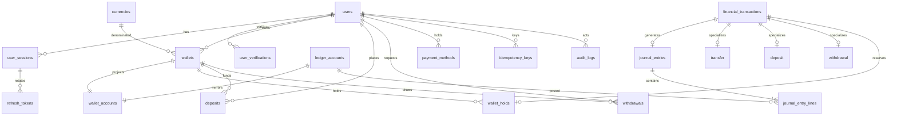

# NEXUS BANK — Database Design

PostgreSQL 17, schema managed by Prisma migrations (`prisma/migrations/*/migration.sql`). All
financial amounts are `BIGINT` minor units. See also `docs/FINANCIAL_LEDGER.md` for the accounting
model and `docs/ARCHITECTURE.md` for how services use these structures.

## Design principles

1. **The journal is the source of truth.** `journal_entries` / `journal_entry_lines` are
   append-only. Wallet balances are projections, never authoritative.
2. **Integrity in the database, not only in code.** Check constraints, unique indexes and deferred
   constraint triggers re-verify every invariant at COMMIT time. An application bug, a direct SQL
   client or a replayed migration cannot persist inconsistent financial state.
3. **No floating point anywhere.** Money is `BIGINT` minor units; JSON carries both minor units
   and formatted decimal strings.
4. **Idempotency is structural.** `idempotency_keys` is written in the same transaction as the
   financial operation it protects.

## Entity overview

## Notable tables

### Identity & sessions

- **`users`** — `email` unique, `role` (`CUSTOMER|SUPPORT|FINANCE_ADMIN|SUPER_ADMIN`), `status`
  (`PENDING_VERIFICATION|ACTIVE|SUSPENDED|FROZEN|CLOSED`), `passwordHash` Argon2id, optional
  `pinHash`, `totpSecretEncrypted` (AES-256-GCM), lockout counters (`failedLoginAttempts`,
  `lockedUntil`, `pinFailedAttempts`, `pinLockedUntil`). `deletedAt` for soft-delete/closure.
- **`user_sessions`** — one row per device/session; `expiresAt`, `revokedAt`, `revokedReason`.
  Access tokens carry `sid`; middleware rejects revoked/expired sessions.
- **`refresh_tokens`** — `tokenHash` unique (SHA-256 only, never the raw token), `usedAt`,
  `revokedAt`, `replacedByTokenId`, `reuseDetectedAt`. Rotation is one transaction: old token
  marked used/revoked, new row inserted, session expiry extended.
- **`user_verifications`** — `(purpose, tokenHash)` single-use tokens for email verification and
  password reset; `consumedAt` enforced by conditional update (`WHERE consumedAt IS NULL`).

### Wallets & projections

- **`wallets`** — `(userId, currencyCode, name, type, status, isPrimary)`;
  `wallets_one_primary_per_user` partial unique index guarantees one primary per user.
  Closing requires `balanceMinor = 0` and `heldMinor = 0` (application-enforced) and sets the
  wallet `CLOSED` and its ledger account `isActive = false`.
- **`wallet_accounts`** — the balance projection: `balanceMinor`, `heldMinor`, `version` (bumped
  on every change for optimistic concurrency), one row per wallet. Constraints:
  `wallet_accounts_balance_nonnegative`, `wallet_accounts_held_nonnegative`.
- **`wallet_holds`** — reservations for pending withdrawals. `status` (`ACTIVE|CONSUMED|RELEASED`).
  `heldMinor` must equal the sum of this wallet's `ACTIVE` holds — verified at COMMIT.

### Ledger

- **`ledger_accounts`** — chart of accounts. `code` unique; `type`
  (`ASSET|LIABILITY|EQUITY|REVENUE|EXPENSE`), `normalBalance` (`DEBIT|CREDIT`), `isSystem` for
  custodial accounts (`SYS:CASH:*`, `SYS:PAYOUT_CLEARING:*`, `SYS:FEE_REVENUE:*`,
  `SYS:ADJUSTMENT_EXPENSE:*`, `SYS:ADJUSTMENT_INCOME:*`), per-wallet `LIABILITY` account
  (`WALLET:<walletId>`). One row per (kind, currency).
- **`journal_entries`** — reference unique, `currencyCode`, `transactionId`, `reversesEntryId`
  (unique — at most one reversal per entry). No UPDATE/DELETE allowed (trigger).
- **`journal_entry_lines`** — `debitMinor ≥ 0`, `creditMinor ≥ 0`, exactly one side non-zero per
  line (`journal_lines_one_sided`), references `ledger_accounts`. No UPDATE/DELETE allowed.

### Financial products

- **`financial_transactions`** — the transaction envelope (`reference` unique, `type`, `status`,
  `amountMinor`, `feeMinor`, parties, `completedAt`). Types: `DEPOSIT|WITHDRAWAL|TRANSFER|FEE|REFUND|REVERSAL|ADJUSTMENT`.
  `REVERSAL` is the single sanctioned mechanism for undoing money movement.
- **`transfers`** — sender/recipient wallets, amounts, denormalized fee.
- **`deposits`** — `providerReference` unique (provider idempotency), `expiresAt`, lifecycle
  `PENDING → COMPLETED|FAILED|EXPIRED`.
- **`withdrawals`** — `status` machine `PENDING|UNDER_REVIEW → APPROVED → PROCESSING →
  COMPLETED|FAILED` (+ `REJECTED|CANCELLED`), `payoutReference`, `payoutAttempts`,
  `reviewedById`, `rejectionReason`.
- **`payment_methods_reference`** — tokenized payout bank accounts; never raw account numbers.
- **`webhook_events`** — `(provider, eventId)` unique; `payloadHash`, `status`
  (`PROCESSED|IGNORED|FAILED`). Used for exactly-once webhook semantics.

### Idempotency, limits, audit, security

- **`idempotency_keys`** — `(userId, scope, key)` unique; `requestHash` (SHA-256 of the canonical
  payload with secrets excluded), `status` (`IN_PROGRESS|COMPLETED|FAILED`), stored `responseBody`,
  24h TTL. Written inside the same transaction as the financial operation.
- **`transaction_limits`** — per `scope` (`TRANSFER|DEPOSIT|WITHDRAWAL`) × currency × optional
  user; per-transaction min/max, daily and monthly caps. Null caps disable the dimension.
- **`fee_policies`** — per `operation` × currency: `flatMinor`, `percentBps` (rounded up),
  `minFeeMinor`, optional `maxFeeMinor`. Seeded: transfer/deposit free, withdrawal 0.50 flat
  capped at 5.00.
- **`audit_logs`** — append-only; actor, role, action, entity, before/after JSON, reason.
- **`notifications`** — user-facing inbox (`readAt`, unread count).
- **`security_events`** — structured detections: `LOGIN_FAILED`, `REFRESH_TOKEN_REUSE`,
  `PIN_LOCKED`, `WEBHOOK_SIGNATURE_INVALID`, `SUSPICIOUS_TRANSACTION`, … with severity.
- **`currencies`** — USD/EUR/GBP, exponent (2), `isActive`.

## Enforced invariants (and where)

| Invariant | Enforced by |
|---|---|
| Journal entry balances and uses ≥ 2 accounts | `nexus_assert_journal_balanced` constraint trigger (deferred) + domain check in `LedgerService` |
| No currency mixing inside a journal | `nexus_assert_journal_balanced` (`NEXUS_JOURNAL_CURRENCY_MISMATCH`) + domain |
| `balanceMinor ≥ 0`, `heldMinor ≥ 0`, `held ≤ balance` | CHECK constraints + `nexus_assert_wallet_account` (`NEXUS_INSUFFICIENT_FUNDS`) |
| Projection == ledger sum per wallet | `nexus_assert_wallet_account` (`NEXUS_BALANCE_DRIFT`) via deferred constraint triggers on journal lines / wallet accounts |
| `heldMinor` == Σ active holds | `nexus_assert_wallet_account` (`NEXUS_HOLD_DRIFT`) via trigger on hold changes |
| Journal & audit are append-only | `nexus_deny_mutation` BEFORE UPDATE/DELETE triggers |
| One primary wallet per user | `wallets_one_primary_per_user` partial unique index |
| Unique provider reference / event id / idempotency key | Unique indexes |
| Non-negative, one-sided journal lines | `journal_lines_amounts_nonnegative`, `journal_lines_one_sided` |
| Limits and fee sanity | `transaction_limits_ranges`, `fee_policies_percent_range`, `fee_policies_nonnegative` |

Deferred constraint triggers run at COMMIT, so multi-statement transactions (create journal → bump
projection) are validated as a whole. If anything is off, the entire transaction rolls back with
`NEXUS_*` error messages (mapped by `error-handler.ts`).

## Migration and reset strategy

- Schema changes ship only as Prisma migrations; `prisma migrate deploy` applies them (CI and
  `docker-compose` run it automatically). Development uses `prisma migrate dev`.
- Test database is rebuilt per run: `tests/helpers/db.ts` truncates every public table except
  `_prisma_migrations` (`TRUNCATE … RESTART IDENTITY CASCADE`) and re-seeds reference data.
- Append-only tables make row-level `DELETE` impossible — TRUNCATE is the only reset mechanism,
  which is why it is confined to the guarded test database (`NODE_ENV=test` + `nexus_bank_test`
  guard).

## Backup & restore notes (educational)

`pg_dump nexus_bank > backup.sql` / `psql nexus_bank < backup.sql`. For anything hosting
meaningful data, use PITR (WAL archiving), encrypt dumps at rest, and treat the database as
crown-jewel material: it contains password digests, token digests, encrypted TOTP secrets, PINs
(peppered), hashed IPs, audit history.
