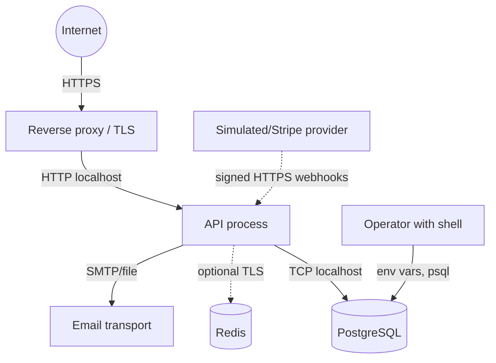

# NEXUS BANK — Threat Model

STRIDE-per-element analysis over the main components. "Mitigated" means an implemented control;
"Partial" means implemented with gaps; "Accepted" means explicitly out of scope (see
`docs/SECURITY.md` §Known gaps).

## Scope and assets

Assets, in loss order: (1) integrity of the ledger (money correctness), (2) customer funds,
(3) customer credentials and sessions, (4) audit/security telemetry, (5) availability,
(6) confidentiality of personal data (names, emails, hashed IPs, device names).

Out of scope: host compromise, malicious PostgreSQL superuser, malicious platform operator with
raw disk access, physical attacks, supply-chain compromise of npm packages (partially addressed by
lockfile pinning, not modeled).

## Trust boundaries

## Threats and mitigations

### S — Spoofing

| # | Threat | Disposition | Controls |
|---|---|---|---|
| S1 | Credential stuffing/brute force | Mitigated | Generic `INVALID_CREDENTIALS`, 5 attempts ⇒ 15-min lock (`ACCOUNT_LOCKED`), timing equalized for unknown accounts, `LOGIN_FAILED`/`LOGIN_LOCKED` events |
| S2 | stolen password hash (DB dump) offline crack | Mitigated (weak passwords still lose) | Argon2id, strong policy, pepper on PINs, HMAC IPs |
| S3 | stolen/replayed refresh token | Mitigated | Rotation + digest-only storage; reuse ⇒ family revocation + CRITICAL event |
| S4 | forged webhooks (fake provider) | Mitigated | HMAC over raw bytes + timestamp tolerance + `(provider,eventId)` dedupe + amount/currency cross-check |
| S5 | session fixation/hijack via cookie | Mitigated | HttpOnly SameSite=Strict, `Path=/api/v1/auth`, Secure in production, short-lived access tokens |
| S6 | MFA fatigue / TOTP replay | Mitigated | per-step replay guard (`totpLastUsedStep`), ±1 window, encrypted secret |

### T — Tampering

| # | Threat | Disposition | Controls |
|---|---|---|---|
| T1 | directly editing balances/ledger rows | Mitigated | Append-only triggers; deferred constraint triggers re-verify projections vs ledger at COMMIT; app refuses to write projections except via ledger |
| T2 | forging/reordering a single webhook | Mitigated | Raw-body HMAC; provider event dedupe; amount/currency match |
| T3 | man-in-the-middle on API transport | User-side risk | TLS terminated at proxy/LB (out of repo); HSTS documented; localhost dev only plain HTTP |
| T4 | tampering with audit trail | Mitigated | `audit_logs` append-only trigger; financial journals immutable |
| T5 | mass assignment of role/status | Mitigated | strict Zod `.strict()` objects; DTOs pick explicit fields; RBAC checked server-side |

### R — Repudiation

| # | Threat | Disposition | Controls |
|---|---|---|---|
| R1 | user denies a transfer | Mitigated | PIN gate + completed transaction row + journal + audit + notification; statements export with same data |
| R2 | admin denies a ledger adjustment | Mitigated | `X-Admin-Confirmation` + reason required + `LEDGER_ADJUSTMENT` audit entry with before/after |
| R3 | provider denies webhook | Mitigated | `webhook_events` stores payload hash, timestamps, processing result |

### I — Information disclosure

| # | Threat | Disposition | Controls |
|---|---|---|---|
| I1 | verbose errors leak internals | Mitigated | 5xx generic body + requestId; internals only in server logs at error level; 4xx `details` limited to actionable fields |
| I2 | email/PII in logs or CSV | Mitigated | CSV formula-injection sanitize; logs redacted (no password/PIN/token/IP raw) |
| I3 | enumeration via register/reset | Mitigated | registration returns 409 on duplicate (accepted trade-off for UX) vs reset always 202; verification responses uniform |
| I4 | OTPs/tokens in URL or logs | Mitigated | tokens only in email body/JSON body; cookies scoped; no token in query strings |
| I5 | metrics endpoint leaks volumes | Mitigated | `/metrics` gated by `METRICS_ENABLED` (+ optional token) |
| I6 | user data via wallet id guessing | Mitigated | cuid unguessable ids + ownership filters on every query (`findFirst({ userId })`) + 404-not-403 for foreign resources |

### D — Denial of service

| # | Threat | Disposition | Controls |
|---|---|---|---|
| D1 | volumetric HTTP flood | Partial (out of repo for volumetric) | Global rate limit, JSON body caps, connection limits at proxy, no expensive unauthenticated endpoints (auth surface only) |
| D2 | slowloris/slow read | Partial | Express server timeouts (`headersTimeout`, `requestTimeout`) in `server.ts`; proxy timeouts documented |
| D3 | expensive queries (CSV exports) | Mitigated | CSV export cap 5,000 rows; pagination caps; statement date window optional but bounded page sizes |
| D4 | lock-contention abuse (parallel transfers) | Mitigated | advisory locks per user; wallet row locks deterministic order; `maxWait 5s` → clean 409/422 instead of hangs; concurrent double-spend covered by integration tests |
| D5 | zip-bomb / giant JSON | Mitigated | 1mb JSON limit, `limit` enforced before parsing |

### E — Elevation of privilege

| # | Threat | Disposition | Controls |
|---|---|---|---|
| E1 | role escalation via profile endpoint | Mitigated | Profile DTO writes name only; role/status changes only via SUPER_ADMIN routes with confirmation + audit |
| E2 | accessing admin routes as customer | Mitigated | middleware RBAC + service-level `assertPermission`; tested in integration suite |
| E3 | bypassing PIN via direct service call | Partial | Services only call `PinService`; no "skip PIN" flag; payout worker shares the same `processPayout` code path as inline execution |
| E4 | JWT algorithm confusion | Mitigated | HS256 pinned; verification rejects other algorithms; issuer/audience enforced; `typ` claim checked |
| E5 | horizontal move via webhook secret | Accepted | One webhook secret per provider; isolate secrets per environment; rotation documented |
| E6 | admin abuse (legitimate insider) | Partial | Confirmation headers + unavoidable audit; but no dual-control (four-eyes) yet — noted |

## Residual risks (accepted, monitored)

- Insider with SUPER_ADMIN can do anything an admin can; dual control absent (R2/E6).
- Rate limiting is per-IP and per-user; distributed botnets need upstream WAF/Anycast (D1).
- Reconciliation is asynchronous (manual trigger or post-op); drift pages only if someone runs it.
- Availability of Redis (if `RATE_LIMIT_REDIS=true` or queue enabled) is a hard dependency —
  single-replica Redis SPOF for the queue path; inline payouts mitigate.
- Postgres is a single instance — no read replicas; availability SLO depends on your infra.

## Review cadence

Re-run this model whenever: the ledger model changes; a new endpoint is added; auth flows change;
a provider integration is added; the threat detector list (`security_events`) grows.
