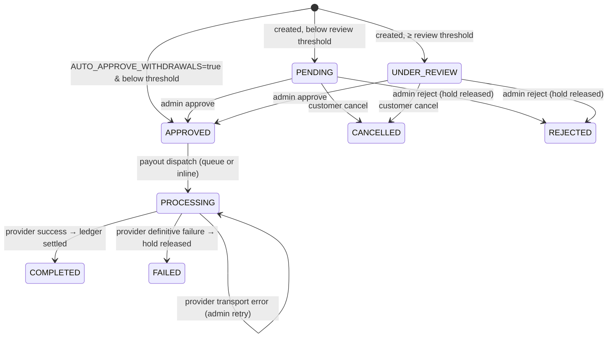

# NEXUS BANK — Transaction Flows

Step-by-step behavior for the core flows, mapped to code paths. Line references use repository
paths. Amounts are minor units. All mutating financial endpoints require `Idempotency-Key`.

## Conventions

- `→ BEGIN/COMMIT` marks the database transaction boundary.
- "Locks" = advisory lock per user (`pg_advisory_xact_lock`) then `FOR UPDATE` on wallet rows
  **ordered by `wallet_accounts.id`**. External calls never happen under locks.
- `idempotency` = single record written in the same transaction; replay returns stored response.
- Failures roll back **everything**, including PIN consumption (PIN is verified before the
  transaction starts) and the idempotency record.

---

## 1) Deposit (apply funds)

**Endpoint** `POST /api/v1/deposits` → `POST /api/v1/deposits/:id/simulate` (sandbox)
or a signed provider webhook at `POST /api/v1/webhooks/payments/:provider`.

```mermaid
sequenceDiagram
  autonumber
  participant C as Customer
  participant API as DepositService
  participant GW as Payment gateway
  participant D as PostgreSQL
  C->>API: POST /deposits { walletId, amount } + Idempotency-Key
  API->>API: verify user ACTIVE + wallet ours
  API->>GW: createDepositIntent(deterministicReference)
  Note over GW,API: reference = DEP-<hash(user,key,payload)><br/>no lock held yet; provider idempotent
  API->>D: BEGIN; advisory lock(user); check DEPOSIT limits
  API->>D: insert FinancialTransaction(PENDING) + Deposit(PENDING, expiresAt)
  API->>D: insert idempotency record; COMMIT
  API-->>C: 201 { deposit, simulation: { endpoint } }
  C->>API: POST /deposits/:id/simulate { outcome }
  API->>GW-like: build provider-shaped event, sign with webhook secret
  API->>API: run through real signature verification
  API->>D: BEGIN; insert webhook_events(provider,eventId)
  API->>D: check deposit/amount/currency match
  API->>D: journal (SYS:CASH:* DEBIT / WALLET:* CREDIT); deposit → COMPLETED
  API->>D: COMMIT; notification "Deposit completed"
```

Key properties:

- The provider intent is created **before** any row lock; the deterministic reference makes
  retries safe against orphaned intents.
- Settlement can happen only through a verified webhook (or the sandbox path that re-enters it).
- A deposit stuck at `PENDING` past `expiresAt` is marked `EXPIRED` by the maintenance loop and
  its transaction `CANCELLED`; **no ledger effect occurs**.

## 2) Withdrawal (move funds out)

**Endpoint** `POST /api/v1/withdrawals` with transaction PIN.



Flow:

1. PIN verified **outside** the transaction (`PinService`), then `BEGIN`:
   user/wallet/payout method checks → `WITHDRAWAL` limit check → locks → available balance must
   cover `amount + fee`.
2. `FinancialTransaction(WITHDRAWAL, PENDING|PROCESSING)` + `Withdrawal` row + **`WalletHold`**
   for `amount + fee`; `heldMinor` raised atomically with the guard `balance − held ≥ total`.
3. Status routing (default config): small → `PENDING`, `≥ WITHDRAWAL_REVIEW_THRESHOLD_MINOR`
   (10,000.00) → `UNDER_REVIEW`. `AUTO_APPROVE_WITHDRAWALS=true` promotes small requests straight
   to `APPROVED` and dispatches inline.
4. Admin `approve` → `APPROVED` (+ audit); `reject` → hold released, `REJECTED`, transaction
   `CANCELLED`. Customer `cancel` allowed only from `PENDING|UNDER_REVIEW`.
5. Payout executes **after** the hold transaction commits (inline if `QUEUE_ENABLED=false`, else
   queued to BullMQ — `src/workers/index.ts`). The payout provider amount is `amount + fee`?
   No: provider receives `amountMinor` only; the fee stays in `FEE_REVENUE`.
6. On success: `PROCESSING → COMPLETED`, hold `CONSUMED`, `heldMinor` decreased, journal
   `WALLET:* DEBIT → PAYOUT_CLEARING CREDIT (amount) + FEE_REVENUE CREDIT (fee)`, transaction
   `COMPLETED`.
7. On explicit failure: `FAILED`, hold `RELEASED`, transaction `FAILED`, money untouched.
8. On transport ambiguity: stays `PROCESSING`; `POST /admin/withdrawals/:id/retry-payout` re-issues
   the payout (idempotent at the gateway via `withdrawal:<id>` key).

## 3) Transfer (wallet → wallet)

**Endpoint** `POST /api/v1/transfers` with transaction PIN.

1. PIN verified, then `BEGIN`: sender/recipient checks, currency match, self-transfer rejected.
2. Locks (users advisory sorted, then wallet rows by account id) → limits (`TRANSFER` scope,
   per-transaction + daily + monthly) → balance check (`balance − held ≥ amount + fee`).
3. `FinancialTransaction(TRANSFER, COMPLETED)` + `Transfer` + balanced journal (fee leg optional).
4. Notifications to both parties. `≥ SUSPICIOUS_AMOUNT_MINOR` (50,000.00) emits a
   `SUSPICIOUS_TRANSACTION` security event and is allowed only if within limits.

Reversal: **only staff with `transfers.reverse` permission** (`FINANCE_ADMIN`, `SUPER_ADMIN`),
with `X-Admin-Confirmation: <transferId>` and an `Idempotency-Key`. The recipient's funds are
debited again into the sender's wallet via the exact mirror of the original journal; the original
transaction is marked `REVERSED`; both actions are audited.

## 4) Session & token rotation

```mermaid
sequenceDiagram
  autonumber
  participant C as Client
  participant S as AuthService
  participant D as PostgreSQL
  C->>S: POST /auth/refresh (cookie nexus_rt)
  S->>D: SELECT refresh_tokens JOIN sessions FOR UPDATE
  alt token used/revoked already
    S->>D: mark REUSE + revoke session family
    S-->>C: 401 REFRESH_TOKEN_REUSE (+ security event)
  else valid
    S->>D: mark old used/revoked; insert new token; extend session
    S-->>C: 200 { accessToken } + Set-Cookie rotated refresh
  end
```

- Access tokens are short-lived (15 min default); the session row is authoritative.
- Reuse of a rotated token revokes the whole family — treat as compromise.
- Logout / logout-all / role change / status change / password reset all revoke sessions.

## 5) PIN failure and lockout

1. Wrong PIN → `PIN_FAILED` security event; counter `pinFailedAttempts` increments.
2. At 5 failures: `pinLockedUntil = now + 15min`, counter resets, `PIN_LOCKED` (HIGH) event.
3. While locked, all PIN verifications fail with `423 PIN_LOCKED` regardless of correctness.
4. Successful verification resets the counter.

## 6) Deposit expiry maintenance

- Runs on the API process and in the worker (same `DepositService.expireStale`).
- `PENDING|PROCESSING` deposits with `expiresAt < now` → `EXPIRED`, transaction `CANCELLED`;
  amount never debited; `Idempotency-Key` replay shows the EXPIRED deposit, not a fresh intent.

## 7) Account closure

`DELETE /api/v1/users/me`: requires ACTIVE, all non-closed wallets must have zero balance
(holds block closure too); all sessions revoked; status `CLOSED`. Closed accounts cannot sign in
or transact. Audit events recorded.
